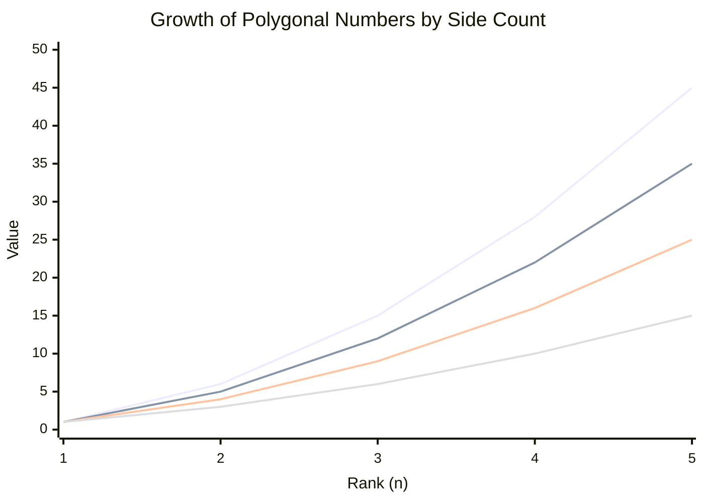

## 12:30 2026/10/14
https://github.com/morluto/rea  
REA: Reverse Engineer Anything
One MCP for reverse engineering across binaries, applications, and runtime behavior.

## 2026-10-16 09:09:39
https://gx.games

bjhit.com 是北京哈工创新计算机网络与信息安全技术研究中心（曾用名：北京哈工大计算机网络与信息安全技术研究中心）的官方网站域名。

机构简介

• 全称：北京哈工创新计算机网络与信息安全技术研究中心
• 建立背景：成立于 2003年，位于北京市西城区。
• 技术方向：主要围绕网络安全监测、安全情报分析、网络安全对抗、新技术安全四大技术方向，提供运营商级别的网络流量分析处理与大数据解决方案。
• 资质成果：该中心拥有 20 余项软件著作权及多项发明专利。

http://mail.bjhit.com/ 重定向到了qqmail，现在404

https://www.bjhd.gov.cn/hdjyzd/article_1830.aspx 北京哈工大计算机网络与信息安全技术研究中心招聘信息
发布日期：2019年11月11日 14:45:02   点击：8821

## 2026-10-17 08:16:33
https://gh.io/copilot-app-win64
https://gh.io/copilot-app-linux

https://github.com/lexmount/moli
Best headless browser for AI agents. Lite, Fast, High-Compatibility. Built in Rust
browser.lexmount.com


### Instagram 和 Facebook 主要区别

1. **关系模式不一样**
   - Facebook：是**好友双向确认制**，类似加微信好友；适合熟人、亲友、同学圈子。
   - Instagram：是**关注 / 粉丝单向模式**，你可以随便关注别人，对方不一定关注你，更偏向兴趣订阅、看博主内容。
2. **内容重心不同**
   - Facebook：图文、长文字、链接、社群小组、活动、二手市集、新闻讨论都有，是全能社交，文字讨论氛围更强。
   - Instagram：**视觉优先**，主打好看照片、短视频，文字一般很短，不适合长篇发帖；靠滤镜、视觉审美出圈。
3. **推荐逻辑**
   - Facebook 动态优先推熟人、好友、群组内容。
   - Instagram（尤其是 Reels）优先按你的兴趣推荐陌生创作者内容，更容易 “出圈涨粉”。
4. **人群氛围**
   - Facebook 年龄层更广，中年人、家庭用户很多。
   - Instagram 年轻人、时尚、美妆、旅行、穿搭博主、创作者更多。

✅ Instagram 上一般用实名吗？

**不强制实名，绝大多数人不用真实姓名**

🆕 vision + audio + video 🆕 视觉+音频+视频
 What Sets Apart 🏆 独特之处
 
 ## `diegosouzapw/OmniRoute` 这个仓库被原管理员转移到 `cheaper-inference` 组织
 
 两种会自动产生重定向的场景

1. ✅ **Transfer（转移归属，这次 OmniRoute 就是这个）**
仓库设置页底部 Danger Zone → **Transfer ownership**，转移给另一个账号 / 组织。
   - 转移后：网页访问、`git clone / fetch / push`、issue、release、wiki 全部自动跳转新地址
   - star、fork、issue 记录一起跟着仓库走
2. ✅ **Rename（单纯改仓库名字，所有者不变）**
比如 `a/foo` → `a/bar`，同样自动重定向GitHub Doc...

> 
> 重点：**不需要任何额外配置**，是 GitHub 平台内置机制。

https://railway.com/deploy?q=omniroute

### ThinkRail
Vibe code with pi in a lightweight, real IDE that customises itself around the way you work — The Vibe You Need
[thinkrail.ai/](https://thinkrail.ai/)
ThinkRail ships in two additive forms: a native desktop installer and the self-contained `thinkrail` CLI. Both are published with `SHA256SUMS` on the [releases page](https://github.com/JetBrains/thinkrail/releases).

### curl --help all

```PowerShell
PS D:\app\curl-8.23.0_5-win64-mingw\bin> .\curl.exe -h -Z
    -Z, --parallel
            Make curl  perform all  transfers in  parallel as  compared to  the
            regular serial manner.  Parallel transfer means  that curl runs  up
            to N  concurrent transfers  simultaneously and  if there  are  more
            than N  transfers  to  handle,  it starts  new  ones  when  earlier
            transfers finish.

            With parallel  transfers, the  progress meter  output is  different
            from when doing serial transfers, as it then displays the  transfer
            status for multiple transfers in a single line.

            The  maximum   amount  of   concurrent   transfers  is   set   with
            --parallel-max and it defaults to 50.

            This option is global  and does not need  to be specified for  each
            use of --next.  Providing --parallel  multiple times  has no  extra
            effect. Disable it again with --no-parallel.

            Example:
             curl --parallel https://example.com -o file1 https://example.com \
                  -o file2

            Added in  7.66.0. See  also --next,  --verbose, --parallel-max  and
            --parallel-immediate.
```

### Cloudflare Free
Free
$0
Deploy apps on Cloudflare's global platform with free Workers, D1, R2, Pages, DNS, SSL, and CDN included.


Workers: 100K requests/day

D1: 5 GB storage

R2: 10 GB storage

Pages: unlimited static sites

Universal SSL certificate

Fast, easy-to-use DNS

Global CDN
Included with every Cloudflare account
Rules
70

Cloudflare Rules
5

WAF Rules
Support
Community
Documentation

### Zeus
Zeus (https://www.google.com/search?kgmid=%2Fm%2F088pn&q=Zeus) most commonly refers to the supreme deity in ancient Greek religion and mythology, or the modern entertainment platform.

1. Greek Mythology (Zeus)

• Role: King of the gods, ruler of Mount Olympus, and god of the sky, thunder, lightning, law, order, and justice. [1] (https://en.wikipedia.org/wiki/Zeus), [2] (https://www.greekmythology.com/Olympians/Zeus/zeus.html), [3] (https://www.theoi.com/Olympios/Zeus.html)
• Family: Son of the Titans Cronus and Rhea; brother to Poseidon, Hades, Hera, Hestia, and Demeter; husband and brother to Hera. [1] (https://www.greekmythology.com/Olympians/Zeus/zeus.html), [2] (https://www.thoughtco.com/profile-of-the-greek-god-zeus-111915), [3] (https://www.theoi.com/Olympios/Zeus.html), [4] (https://en.wikipedia.org/wiki/Zeus)
• Mythology: Overthrew his father Cronus during the Titanomachy, split the cosmos with his brothers, and fathered numerous gods and heroes (such as Athena, Apollo, Artemis, and Heracles). [1] (https://www.britannica.com/topic/Zeus), [2] (https://www.youtube.com/watch?v=InQTFkUa7Kw&t=3), [3] (https://www.greekmythology.com/Olympians/Zeus/zeus.html), [4] (https://www.theoi.com/Olympios/Zeus.html)
• Roman Equivalent: Known as Jupiter (or Jove) in ancient Roman religion. [1] (https://www.theoi.com/Olympios/Zeus.html), [2] (https://en.wikipedia.org/wiki/Zeus)

2. The Zeus Network

• Type: A subscription-based video-on-demand streaming service. [1] (https://www.thezeusnetwork.com/), [2] (https://www.youtube.com/channel/UCfDNb4_8cwo8hOWpC61y5wA)
• Content: Focuses on unscripted original reality series, reunions, and influencer-driven programs like Baddies and Bad Boys. [1] (https://www.thezeusnetwork.com/), [2] (https://www.youtube.com/channel/UCfDNb4_8cwo8hOWpC61y5wA)
• Access: Available via the Zeus Network Website or mobile and streaming device apps. [1] (https://www.thezeusnetwork.com/), [2] (https://www.youtube.com/channel/UCfDNb4_8cwo8hOWpC61y5wA)

3. Esports (Choi "Zeus" Woo-je) (https://www.google.com/search?kgmid=%2Fg%2F11n16k4q_c&q=Choi+%22Zeus%22+Woo-je%29)

• Type: Professional League of Legends top-laner. [1] (https://lol.fandom.com/wiki/Zeus)
• Career: Known for winning back-to-back World Championships and multiple MVP awards. [1] (https://lol.fandom.com/wiki/Zeus)
Are you looking for information on Greek mythology, the Zeus Network streaming service, or esports player Choi "Zeus" Woo-je?


Ghidra软件逆向工程框架
https://github.com/nationalsecurityagency/ghidra

https://google.github.io/comprehensive-rust/

https://zeabur.com/templates/VTZ4FX

https://zeabur.cn/zh-CN/

https://bestcf.pages.dev/

https://bestcf.pages.dev/tiancheng/all.txt

https://www.audiotent.com/collections/midi-files?gad_source=1&gad_campaignid=23946739097

OmniGet = 一个把各种互联网内容“下载 + 处理 + 管理”整合到一起的开源桌面工具。
https://github.com/tonhowtf/omniget

惠普的 16 英寸战99 Ultra（
​搭载锐龙 AI Max+ 495 处理器，100W 性能释放。内存 192GB，可以划 160G 当显存。

https://github.com/libnyanpasu/clash-nyanpasu

https://github.com/hypit-ai/hypit

https://github.com/you-dont-need/You-Dont-Need-JavaScript
CSS is powerful, you can do a lot of things without JS.

Valve 开源 Lepton，安卓游戏上 Linux

30MB内存替代Chromium！Obscura 开源Rust无头浏览器

觞觥觚斛：shāng gōng gū hú

Orca IDE  
Ship 100x with the agent IDE
Run Claude Code, Codex, and any other coding agent in parallel. Get the mobile companion for iOS or Android.

https://github.com/stablyai/orca

https://github.com/jamiepine/voicebox
The open-source AI voice studio. Clone, dictate, create

https://github.com/ZeroLu/awesome-seedance/blob/main/README-zh.md
Seedance 2.0（即梦） 优质提示词、视频生成技巧以及高级 Seedance AI 实验资源的精选集合。

DBX 用Rust和Tauri写的数据库管理工具

中科曙光N50 Pro是2026年9月7日刚刚发布的国产移动工作站笔记本。这款机型定位高端专业生产力设备（64线程处理器、最高128G内存、最高8TB存储、16G显存专业显卡、4K 120Hz专业屏），业内预估正式售价大概率会处于3万元起步区间，高配版本价格会更高

1. 先核验硬件：用CPU-Z、GPU-Z核对硬件真实型号，用CrystalDiskInfo查硬盘通电时长，确认是否为翻新/虚标机。

https://github.com/JustVugg/colibri
GitHub现在最火热的大模型开源小蜂鸟Colibrì，纯C实现、零引擎依赖的分层推理框架 Run frontier MoE models on hardware you already own

```cmd
winget export -o C:\softwarelist.json

winget import -i C:\softwarelist.json
```

github.com/multimodal-art-projection/YuE  
YuE：先写曲谱再生成歌曲的音乐模型。该项目是开源的歌曲生成模型，输入歌词和风格描述，即可生成包含人声与伴奏的完整歌曲。它会先生成旋律与和弦乐谱，再根据乐谱生成音频，支持编辑曲谱后重新生成歌曲，也能根据参考录音进行翻唱。配套 Skill 还支持生成纯器乐。

“新四害”并非官方统一固定的定义，而是随着社会发展、不同场景衍生出的不同说法，常见的几个版本包括网络谣言、饭圈文化、网络暴力、极端言论；高房价、短视频泛滥、直播售假、网络诈骗；黑作坊、黑工厂、黑市场、黑窝点等，具体如下：
 
1. 网络新四害（网友票选版本）
- 这是观察者网发起投票后，由网民评选出的互联网领域公害，分别是网络谣言、饭圈文化、网络暴力、极端言论。
- 这类行为会破坏网络讨论氛围，误导公众认知，还可能对个体造成心理伤害，激化社会矛盾。
2. 社会问题类版本（民间热议版本）
- 该版本聚焦影响百姓日常生活的突出社会问题，具体包括高房价、短视频泛滥、直播售假、网络诈骗。
- 这些现象不仅给人们的经济利益带来损害，还会影响生活节奏与精神状态，比如高房价让很多年轻人购房压力剧增，短视频泛滥可能导致人们专注力下降。
3. 专项治理类“新四害”
- 2011年公安部开展“打四黑除四害”专项行动时，将“黑作坊”“黑工厂”“黑市场”“黑窝点”视为当时的“新四害”。
- 这些“四黑”涉及制假售假、涉黄涉赌涉毒等违法犯罪活动，严重危害百姓健康、破坏市场秩序和社会风气。
4. 生活观念类版本（民间调侃版本）
- 还有一种聚焦人们精神与消费层面的说法，认为攀比之风、各类焦虑、网贷过度消费、信息过载与谣言是“新四害”。
- 比如职场35岁危机、教育焦虑等困扰着很多人，网贷过度消费也常让年轻人陷入经济困境。

https://github.com/vlang/vinix

Rust 做桌面终于不用手搓界面了，gpui-kit 备好 75 个组件

79岁的2013年诺贝尔化学奖得主、斯坦福大学教授迈克尔·莱维特，每天花约10小时与AI聊天，日均提问数百个，已深度使用AI近4年。

上海自来水来自海上； 中山落叶松叶落山中。
明朝古寺； 暗渡陈仓。

https://winprog.org/tutorial/simple_window.html

https://nekoweb.org/

https://railway.com/deploy/ubuntu-ssh-claude
Nekoweb is a free website hosting service, created in 2022 2023 2024 by a group of coders, programmers and artists, passionate for the old web and personal websites.
Social media is too limiting. 

https://gameguardian.net/forum/  
Overview: Play games your way! “GameGuardian” is a game cheat / hack / alteration tool.

https://github.com/stremio/stremio-web
Freedom to Stream — the official web UI of Stremio, a modern media center that's a one-stop solution for your video entertainment.

https://github.com/alishahryar1/free-claude-code

https://github.com/lexmount/moli  
Moli 是一款面向 AI 智能体、可用于生产环境的无头浏览器。它采用按需布局与渲染的设计，兼顾完整的浏览器运行时与轻量的资源占用。

Moli 可以帮助你的 AI 智能体抓取和提取网页、搜索网络，以及自动化各类浏览器任务。

你可以通过 CLI、CDP、WebDriver Classic 或 WebDriver BiDi 来使用它。

Moli 支持 Linux、macOS 和 Windows。

快速开始
把这句话发给你的 AI 智能体：

安装 https://github.com/lexmount/moli/tree/main/skills 下面的 skills，
根据 skills 指引下载并安装最新版预编译 Moli 二进制，然后用 moli-webfetch
抓取 https://example.com 并把结果给我。
Render the page as Markdown with Moli's default completion strategy:

moli fetch \
  --dump markdown \
  --wait-until done \
  https://example.com
Or directly return a compact, model-friendly semantic tree:

moli fetch \
  --dump semantic_tree_text \
  --wait-selector body \
  https://example.com
For visual output, enable on-demand layout and write a viewport PNG, a full-document PNG, or a paginated PDF:

moli fetch --layout --dump screenshot https://example.com > page.png
moli fetch --layout --dump screenshot_full https://example.com > full-page.png
moli fetch --layout --dump pdf https://example.com > page.pdf

https://github.com/shafreeck/Tunnet

https://www.google.com/search?q=google+games

https://getartcraft.com/
https://artcraftsuite.org/tools/soundcraft/
https://github.com/storytold/gridcraft
github.com/storytold/filmcraft

5 个月，Anthropic 从零开发出了内部源代码控制系统 Scion、配套的代码审查工具 Antique 以及其他多个相关系统，并完成了整个单体代码仓库从 Git 到 Scion 的迁移。

GitHub 上一个叫 REA（Reverse Engineer Anything）的项目狂揽了近 7 万颗星
可选（二进制程序深度反编译）：Ghidra（免费） 或 Hopper（付费）

<iframe width="100%" height="468" src="https://www.youtube.com/embed/5gIf0_xpFPI?si=N1WTorLKL0uwLsU_" title="YouTube video player" frameborder="0" allowfullscreen></iframe>

npm create astro -- --template starlight

今天分享一个非常实用的开源工具——Teledrive。
它可以利用 Telegram 的云存储能力，把 Telegram 转变成一个类似 Google Drive 的私人云盘。
Back up and browse your files using a private Telegram channel as storage

https://github.com/zhishile/codex-auth-helper
Codex登陆助手：安全地在本地导出您的已登录 ChatGPT 会话配置，生成符合 Codex 规范的 auth.json 本地备份文件  将 auth.json 移动到本机 Codex 配置目录中：
```
Windows: %USERPROFILE%\.codex\auth.json

macOS: ~/.codex/auth.json
```
https://codex.afione.com/

https://gitingest.com/llms.txt  
Turn any Git repository into a prompt-ready text digest. GitIngest fetches, cleans, and formats source code so AI agents and Large Language Models can reason over complete projects programmatically.

https://deepwiki.com/facebook/react
gitmcp.com
gitingest.com

ai指令大全及使用方法

https://github.com/hmjz100/LinkSwift
一个基于 JavaScript 的网盘文件下载地址获取工具。基于【网盘直链下载助手】修改 
https://raw.githubusercontent.com/hmjz100/LinkSwift/dev/%EF%BC%88%E6%94%B9%EF%BC%89%E7%BD%91%E7%9B%98%E7%9B%B4%E9%93%BE%E4%B8%8B%E8%BD%BD%E5%8A%A9%E6%89%8B.user.js

https://github.com/donchitos/claude-code-game-studios

### 数学奖项含金量排名
数学没有官方统一含金量排名，阿贝尔奖、菲尔兹奖、沃尔夫数学奖是国际数学三大最高奖，定位不同不能简单分高低。
 
国际顶级数学奖项
 
1. 阿贝尔奖（Abel Prize）
挪威设立，每年颁发，无年龄限制，奖励终身基础性重大成就，奖金约100万美元，对标诺贝尔奖，是目前奖金最高数学奖。
2. 菲尔兹奖（Fields Medal）
国际数学家大会颁发，每4年一次，仅限40岁以下数学家，奖励突破性青年成果，俗称“数学界诺贝尔奖”，代表青年学者最高荣誉。
3. 沃尔夫数学奖（Wolf Prize）
以色列沃尔夫基金会，每年颁发，终身成就奖，不限年龄，很多菲尔兹奖得主晚年再拿沃尔夫奖，是对一生学术贡献的肯定。
 
三者关系：菲尔兹奖看青年突破性成果；阿贝尔、沃尔夫看毕生学术贡献。阿贝尔奖2003年才创立，历史比沃尔夫短，现在认可度已持平沃尔夫奖。
 
其他重要国际奖项
 
- 陈省身奖（ICM）：国际数学家大会颁发，终身成就奖，表彰对数学整体的杰出贡献。
- 高斯奖：国际数学家大会，奖励应用数学重大贡献。
- 奈望林纳奖：奖励理论计算机科学相关数学，40岁以下青年学者。
- 克雷千禧年大奖：7个难题，每解决一个奖励100万美元，属于问题悬赏，不是常规学术奖项。
 
国内主要数学奖项（国内含金量）
 
1. 华罗庚数学奖：中国数学会，国内数学终身成就最高奖，奖励国内资深数学家。
2. 陈省身数学奖：奖励国内中青年杰出数学家，国内青年数学最高奖。
3. 钟家庆数学奖：面向优秀数学博士研究生，青年学生最高奖。
 
简单通俗对比
 
- 青年学者天花板：菲尔兹奖
- 终身成就天花板：阿贝尔奖、沃尔夫数学奖
- 应用数学最高：高斯奖
- 国内终身：华罗庚数学奖；国内中青年：陈省身数学奖
 

Rust 打造的Bevy游戏引擎，凭什么要挑战 C++ 的 40 年霸权

https://www.avo.bet/#hero 

### railway
ssh railway.new
agent
make me a Tetris game

https://railway.com/changelog/2026-09-25-free-vms-without-an-account

While you're on the Limited Trial, you can initiate verification at any time by visiting 
railway.com/verify
 in order to access the Full Trial experience.

### 2026-10-17
https://devblogs.microsoft.com/vscode-blog/

https://github.com/debpalash/VoiceStudio/blob/main/README_CN.md

Bolt.new 是由 StackBlitz 推出的一款基于 AI 的全栈 Web 开发与部署平台。 [1] (https://sourceforge.net/projects/bolt-new.mirror/), [2] (https://zhuanlan.zhihu.com/p/2061134270828225278)

核心特点：

• 浏览器中直接运行：依托 StackBlitz 的 WebContainers 技术，它可以在浏览器沙盒中直接运行完整的 Node.js 环境，无需在本地电脑安装任何开发环境或配置软件。
• 自然语言对话建站：用户只需通过文字描述需求（如做一个网页、小游戏或 SaaS 应用），AI 就会自动编写前端、后端代码并配置数据库。
• 实时预览与一键部署：界面支持实时代码预览，并可将开发好的应用一键部署上线。
• 适合多类人群：无论是专业开发者用来快速做原型，还是产品经理、设计人员甚至零基础小白，都可以通过它把想法快速变成真实的 Web 应用。 [1] (https://ai.engineer/orgs/bolt-new-stackblitz), [2] (https://ad.yiban.io/operate/tool/1008), [3] (https://www.cnblogs.com/tangshiye/p/18659205), [4] (https://ai-bot.cn/bolt%E2%80%A4new/), [5] (https://www.youtube.com/watch?v=8FrAgeE6nYM), [6] (https://zhuanlan.zhihu.com/p/2061134270828225278), [7] (https://sourceforge.net/projects/bolt-new.mirror/)
如果你想了解如何上手使用、它的免费额度限制，或者想把它和 Cursor / v0 做个对比，可以随时告诉我！

OperaGX 浏览器 apk 下载地址  
https://download.opera.com/download/get/?partner=www&nothanks=yes&product=android-gx&download_url=https%3A%2F%2Foperagx.gg%2Fmobile-lp-android

rust语言的优缺点

https://gpui-kit.com

MacOS X users, click here: ssh://new@sdf.org
Web Browser users may use our HTML5 SSH client: https://ssh.sdf.org
Linux/UNIX users can type 'ssh new@sdf.org' at their shell prompts.

一个人，一个 HTML 文件，我把游戏挂上了 TapTap
当然，上架 TapTap 还是要套个壳。流程比想象中简单：用打包工具把 HTML 包成 APK，准备软著，提交审核，全程一个人搞定。

taptap怎么上架h5游戏
TapTap上架H5游戏有两种方式：直接上传H5小游戏zip包，或者把H5打包成APK套壳上架安卓版

Cloudflare CLI 1.0.0-beta.16 includes cf docs search, so you and your coding agent can find Cloudflare documentation without leaving the terminal. Agents can parse the results and fetch a complete page as Markdown. For example, use jq to select the first result, then request its URL with the Accept: text/markdown header:

```
bun add --global cf@latest
cf docs search "proxy a DNS record"
cf docs search "rate limit requests with WAF"
cf docs search "schedule a worker"

url=$(cf docs search "proxy a DNS record" | jq -r '.[0].url')
curl -H "Accept: text/markdown" "$url"
```
Cloudflare 在 2026 年 9 月底发布了 cf 的公开测试版（Open Beta），并计划逐步淘汰 Wrangler。

RackNerd
Global cloud and AI infrastructure from RackNerd, including KVM VPS, AI VPS, dedicated servers, web hosting and
2026 新年促销最低配只要 11.29 美元/年，算下来每个月不到 1 美元，比买杯奶茶都便宜。配置也不寒酸，1核 1G 内存 24GB SSD 硬盘，每月 2TB 流量配 1Gbps 带宽，用来跑个人博客或者搭个梯子完全够用。

https://www.adspower.net/
全球 1000万 出海从业者
信赖的指纹浏览器
为每个账号创建独立浏览器环境，
在同一台电脑上安全管理上千个账号，有效降低封号风险。
npx skills add https://github.com/adspower/adspower-browser --skill adspower-browser


FanVPN 用户量在过去两个月翻倍,节点带宽成本已超出个人能维持的范围。我们已将免费节点池精简至 4 国 8 节点,聚焦核心质量与稳定性。同时我们也持续听到一些用户的真实需求:想要更稳定的大陆方向线路、想要全平台使用而不只是 Chrome。

所以我们做了 云帆 Cloudsail —— 一个独立的付费机场。

https://youtube.com/shorts/3s6FUqabsjM?si=rF0-nsC_GRucJuHa

《Claude Code实战：从 Vibe Coding 入门到智能体工程》

讲起湖南师范大学，熟悉长沙的长沙满哥、妹陀脑海里浮现的，多半是岳麓山脚下的二里半、麓山南路上的林荫道。不过，要是把视线顺着湘江一路向南移，在大王山以南的湘江科学城片区，湖南师大一座崭新的现代化新校区——湖南师范大学科创港校区，正在紧锣密鼓地长出地面。


The Erdős–Szekeres Theorem (mn + 1)

• Statement: Any sequence of mn + 1 distinct real numbers must contain either an increasing subsequence of length m + 1 or a decreasing subsequence of length n + 1.

In mathematics, the Erdős–Szekeres theorem asserts that, given 
r and s, any sequence of distinct real numbers with length at least 
 (r-1)(s-1)+1 contains a monotonically increasing subsequence of length r or a monotonically decreasing subsequence of length s. 
 
A path of four upward-sloping edges in a set of 17 points. By the Erdős–Szekeres theorem, every set of 17 points has a path of this length that slopes either upward or downward. The 16-point subset with the central point removed has no such path.

https://www.reddit.com/r/commandline/comments/1sey6x0/yutu_a_cli_tool_to_manage_your_entire_youtube/

一个代码库只能与一个 Back4app 账户连接。因此，如果另一个 Back4app 用户（拥有该特定代码库的 GitHub 权限）在他的 Back4App 账户下重新安装该应用，您的容器应用将不再与该代码库连接。

多边形数（Polygonal number）是数论中的一类有形数（Figurative numbers），指可以排列成正多边形形状的离散点或整数。例如，10 个点可以排成一个正三角形，因此 10 是一个三角形数；而 9 可以排成一个正方形，因此 9 是一个正方形数（平方数）。 [1] (https://zh.wikipedia.org/zh-cn/%E5%A4%9A%E9%82%8A%E5%BD%A2%E6%95%B8), [2] (https://www.wolfram.com/language/11/algebra-and-number-theory/polygonal-numbers.html.zh?footer=lang)
这一概念最早由古希腊的毕达哥拉斯学派在公元前 6 世纪开始研究。 [1] (https://baike.baidu.com/item/%E5%A4%9A%E8%BE%B9%E5%BD%A2%E6%95%B0/9459768), [2] (https://en.wikipedia.org/wiki/Polygonal_number)

📐 通项公式

对于一个 s 边形（s ≥ 3），它的第 n 个多边形数 P(s, n) 的通项公式为：
\(P(s,n)=\frac{(s-2)n^{2}-(s-4)n}{2}\)
也可以写作：
\(P(s,n)=\frac{(s-2)n(n-1)}{2}+n\)
其中 n 表示多边形的层数或阶数（\(n = 1, 2, 3, \dots\)）。通常规定，所有多边形数的第一项都是 1（即 P(s, 1) = 1）。

📊 常见的多边形数

以下是几种最常见的多边形数及其前几项数值： [1] (https://www.cnblogs.com/inpeace7/archive/2012/03/23/2414189.html), [2] (https://baike.baidu.com/item/%E5%A4%9A%E8%BE%B9%E5%BD%A2%E6%95%B0/9459768)

多边形类型 (s)	别称 / 通项公式	前 5 项数值
三角形数 (s=3)	\(\frac{n(n+1)}{2}\)	1, 3, 6, 10, 15
正方形数 (s=4)	n²	1, 4, 9, 16, 25
五边形数 (s=5)	\(\frac{n(3n-1)}{2}\)	1, 5, 12, 22, 35
六边形数 (s=6)	n(2n-1)	1, 6, 15, 28, 45


💡 重要定理与性质

1. 费马多边形数定理
业余数学王子费马提出、后由高斯和柯西等人证明的著名定理：每个正整数最多可以表示为 s 个 s 边形数之和。
	• 也就是说，任何整数都可以写成最多 3 个三角形数之和、最多 4 个正方形数之和、最多 5 个五边形数之和，以此类推。 [1] (https://www.cnblogs.com/inpeace7/archive/2012/03/23/2414189.html), [2] (https://baike.baidu.com/item/%E5%A4%9A%E8%BE%B9%E5%BD%A2%E6%95%B0/9459768)
2. 多重多边形属性（多重形数）
有些数字非常奇特，能够同时排成多种不同的正多边形。例如 36 既是第 8 个三角形数（\(\frac{8 \times 9}{2}=36\)），又是第 6 个正方形数（6²=36），它被称为“三角平方数”。 [1] (https://zh.wikipedia.org/zh-cn/%E5%A4%9A%E9%82%8A%E5%BD%A2%E6%95%B8), [2] (https://baike.baidu.com/item/%E5%A4%9A%E8%BE%B9%E5%BD%A2%E6%95%B0/9459768)
3. 与三角形数的关系
所有的 s 边形数都可以通过三角形数 \(T_{n}\) 组合而成。事实上，第 n 个 s 边形数正好等于第 n 个正方形数加上 (s-4) 个第 n-1 个三角形数。


### 多边形数增长趋势图



ext install MermaidChart.vscode-mermaid-chart

https://marketplace.visualstudio.com/items?itemName=MermaidChart.vscode-mermaid-chart
https://marketplace.visualstudio.com/items?itemName=vstirbu.vscode-mermaid-preview

5)在线帮助
输入？会显示帮助列表，? n显示对应主题帮助
? function 会显示function函数的帮助
?? function 是更详细的function帮助
??? function 是所有和function有关联的函数清单
?\ 是显示快捷键的列表，比如#，##等
?. 是显示相关类型的成员函数

gp > P = Polrev([1, 2, 3, 4, 5], 'y)
  %1 = 5*y^4 + 4*y^3 + 3*y^2 + 2*y + 1
  
(10)  t_POLMOD : T[X]/(P)         
  MOD(x, y)中x, y都是多项式
  若z=Mod(x, y)，
  z.pol返回化简后的x
  z.mod返回y
  gp > zz=Mod(x^7+1, x^2+x+1)
  %1 = Mod(x + 1, x^2 + x + 1)
  gp > zz.pol
  %2 = x + 1
  gp > zz.mod
  %3 = x^2 + x + 1
  
[ x+y | x <- [1..3]; y <- [1..2] ] = [2, 3, 3, 4, 4, 5]
[ [x,y] | x <- [1..4], isprime(x); y <- [2..5], y % 3 == 1 ] 
[ [x,y] | x <- [1..4]; y <- [2..5] ] 

m[1,], m[2,]...表示矩阵的行向量
m[,1], m[,2]...表示矩阵的列向量
m[1..2,]表示前两行
m[^1,]表示移除第一行后其他行
m[1,2..3]表示第1行，2-3列
m[2..3，1]表示第1列，2-2行
m[^1, 2..3]表示移除第1行后剩余行的2-3列

https://bbs.emath.ac.cn/ 数学研发论坛。

Borwein's algorithm


onedrive tenfon生成类似的数字+短词新名称，用作开源项目名
最推荐的 10 个

7Forge、3Mesh、9Stack、2Cache、5Byte、8Flow、42Relay、64Vault、1Lens、6Grid

起名规则建议

· 数字选：0/1/2/3/5/7/9/42/64/128/256/404
· 短词选：forge/mesh/stack/cache/byte/grid/flow/vault/relay/lens/pulse/beam/loop
· 避免直接仿 OneDrive、Tenfon 的近音词。

### Little Big City
Little Big City 是一款非常有趣的在线 3D 城市模拟生成器。网站目前提供了球体和立体地图两种形式，只需在右下角输入某一地区的经纬度信息，Little Big City 就会根据真实的地图数据，生成与城市环境对应的立体地图。

https://github.com/TommyMerlin/Awesome-Repository


https://www.haoweichi.com/user-generate

Q = Qfb(1, 0, -9781);  \\定义方程x²+0*x*y- 9781y²
qfbsolve(Q, 397)

Values@Solve[{x^2 - 9781 y^2 == 397, 10^1000 > x > y > 0}, {x, y},  Integers]

商汤小浣熊专场

10月24日 13:30–17:30

世界计算·长沙智谷 A5栋2层多功能厅
https://1024.csdn.net/

https://picocss.com/docs Minimal CSS Framework for Semantic HTML

OpenClaw	NanoBot	PicoClaw	ZeroClaw	🦞 NullClaw
TypeScript	Python	Go	Rust	Zig

https://jonismathnotes.blogspot.com/2015/02/ramseys-theorem.html?m=1
Blogspot latex 
https://quicklatex.blogspot.com/?m=1

https://github.com/opdev1004/mdblogger

MDBlogger is primarily known as a free, open-source Chrome extension that adds a markdown editor directly into the Google Blogger post-editing page.

Developer
Geargom
9 Amesbury Drive Wellington 6037 NZ
Email
opdev1004@gmail.com

https://community.obsidian.md/plugins/markdown-blogger

博客的领域/赛道（Niche）高收益领域：金融理财、保险、软件/科技、Web开发、商业法律、医疗健康等。这些领域的广告商出价高，单次点击可能带来几美元甚至十多美元。   低收益领域：个人日记、生活随笔、普通新闻、文学创作等。这类领域广告单价极低。

限制高级广告网络：当博客流量非常大时（如月访问量 > 5万），行业内通常会转向收益更高的第三方广告联盟（如 Mediavine、Raptive）。而这些平台通常对 Blogger 框架的适配不如 WordPress 灵活。

```
<p>下面是一个 SageMath 的绘图示例：</p>

<!-- 嵌入 SageCell 交互框 -->
<div class="sage">
<script type="text/x-sage">
plot(sin(x), (x, 0, 2*pi))
</script>
</div>
```

```
$ npx @marvae24/douban-cli now

🍿 正在热映

#    片名                 评分   上映    ID
1    生化危机：爆发夜     7.3    10.05   37068446
2    鲸口脱险             6.2    10.16   36806762
3    神探之痕迹           6.8    10.01   37247814
4    一个夜晚与三个夏天   7.2    10.13   36449264
5    野兽之心             7.3    09.30   36828393
```

https://m.sov5.org/search?q=jekyll+plugin&re=1&sst=200

https://github.com/kurtsson/jekyll-multiple-languages-plugin#41-_configyml

Flameshot是一款跨平台开源截图工具，支持截图后直接绘制箭头、文字、方框、马赛克等标注，不用切换其他修图软件

​​​这个名为Awesome Blackhat Tools的项目，简直就是一份数字世界的“全能军火清单”
​​​作者几乎把那些平日里难得一见的顶级网络安全工具全给攒到了一起。从最初步的信息收集，到极具攻击性的漏洞扫描、密码审计，再到深层的取证分析和逆向工程，各种手段应有尽有，逻辑清晰得让人心慌

crynta/terax-ai（项目名 Terax）是一个开源、轻量级的终端优先 AI 原生开发环境（Terminal-first AI-native Development Environment, ADE）

联想YOGA Pro 15 RTX Spark，10月8日开启预售，10月16日正式开售。起步就是64GB LPDDR5X加1TB SSD，顶配给到128GB加2TB。
价格也得说清：海外3000美元起，约合人民币2.1万元，国内定价还没公布

DroidDesk turns your Android phone into a real Linux desktop using Termux, Termux X11, TUR, and Proot. Run VS Code, Firefox, LibreOffice, Blender, and more with X11 or VNC support for monitor setup.

Fronty
特点：图片转HTML，上传截图/设计稿，AI输出HTML+CSS；自带简易编辑器，支持导出源码。
适合：把效果图、截图转成网页代码。
免费：基础版免费，高级导出付费。

https://github.com/nexu-io/html-anything

2026 年更新到 v4.0.0 的开源项目 AirLLM 彻底推翻这个结论 —— 不量化、不蒸馏、不剪枝，完整原始权重无损精度，4GB 消费级显卡就能跑 70B Llama，3.72GB 显存跑 2.8T Kimi K3 MoE 超大模型

OmniRoute 的开源 AI 网关在 GitHub
https://www.omniroute.online/zh-CN/

hypit

http://as.vivo.com/

开源AI管理工具EchoBird，它的核心功能是免切换智能接入，目前已处于启用状态。这是个多模型统一调度平台，能集中接入DeepSeek、GLM、MiniMax等多款大模型，部分还支持免密钥使用，像deepseek-v4.1-flash体验版就属于这类。它能把各类模型转为OpenAI兼容接口，不用频繁更换API，左侧菜单栏有模型管理、账号管理、本地大模型等功能，可以统一管理调度多个AI服务，还支持自动路由和故障切换，视频重点演示了免费DeepSeek模型的接入方案，很适合常需要同时用多款AI工具的用户哦。

https://github.com/citrolabs/ego-lite
The fastest browser for AI agents to run browser automation, built for sharing your logged-in browser state with your AI agents, like Codex or Claude Code, without disturbing you. Zero cost, zero config.

https://notebook.google.com/notebook/e9649781-b8e2-4d37-aa34-df5ce45ae498

邮件转任务：在 Gmail 中收到重要邮件时，可以直接点击顶部的 “添加到任务”（Add to Tasks） 图标，邮件会变成一个带有直达链接的待办事项

cron 定时任务的含义：cron 是服务器/代码层面的概念（如 Linux 的 crontab 或 Google Cloud Scheduler），用于在固定的时间间隔自动执行某段程序、API 请求或脚本。

Google Apps Script (GAS) + 触发器（Trigger）
Google Cloud Scheduler（真正的 Cron 服务）   如果你需要企业级、高可靠性的 Cron 定时任务，Google Cloud 提供了 Cloud Scheduler 服务。它支持标准 Unix-cron 表达式，你可以让它定时向某个目标（如 Cloud Functions 或 Webhook）发送请求
第三方自动化工具（如 Make / Zapier）

如果你不想写代码，可以使用 Make.com 或 Zapier 等自动化平台。它们内置了定时器（Schedule by Zapier/Make）和 Google Tasks 模块，可以轻松实现“每隔 X 天自动在 Google 任务中创建一条新待办”。

### blogspot
一个 Gmail（Google）账号不仅可以创建一个博客，实际上最多可以创建和管理 100 个 Blogspot 博客
共享个人资料：同一个 Google 账号下的所有博客会共用同一个 Blogger 基础公开档案信息（不过你可以在每篇文章里自定义显示不同的作者昵称）

Lark（官网 larksuite.com）= 飞书的海外国际版，同属字节跳动，产品内核一致，但租户、账号、数据、合规体系互相独立、不互通 。
Lark（larksuit.com） vs 飞书（feishu.cn）核心区别
 
1. 服务区域 & 合规
​
- 飞书（feishu.cn）：中国大陆版，遵循国内网信、数据安全法规，数据在国内
​
- Lark（larksuite.com）：国际海外版，面向境外客户，满足海外数据合规要求

开源神器 Terax——Tauri2+Rust+React19 构建，打包仅 7~8MB，9.2k GitHub Star，单窗口整合终端、代码编辑器、Git 可视化、本地 AI 代理，无账号、无遥测、密钥加密存储，支持全离线本地大模型，https://github.com/crynta/terax-ai 

https://curl.se/windows/
You can specify multiple URLs or parts of URLs by writing lists within braces or ranges within brackets. We call this "globbing".

https://example.com/archive[1996-1999]/vol[1-4]/part
https://example.com/file[1-100:10].txt
https://example.com/file[a-z:2]

### SnapDeploy
https://snapdeploy.dev/docs/free-tier

Sleep	After about 15 minutes without traffic	A sleeping container answers with a 503 wake page

Wake	About 60 seconds, on a browser visit	Scripts, cron jobs and CI runners do not wake it

Builds	Up to 60 minutes each	Most finish in 1 to 5 minutes; images build for ARM64

Traffic	100 requests a minute per IP address to one app	Above that the address gets HTTP 429 for 10 minutes; see fair use

Persistent disk	None	The filesystem resets on redeploy, restart and wake; keep state in a database add-on or object storage

Custom domains, WebSockets	Always-On only	From $12 a month per container

Databases	Not included	PostgreSQL, MySQL, MariaDB, MongoDB, Redis and RabbitMQ are paid add-ons, each with a $1 12-hour 

A container can open outbound connections on TCP ports 1 to 27017, except 3333 and 9000 to 9099, plus DNS and NTP over UDP. This is the same on every plan.

Proxies, VPN panels, tunnels and remote shells of any kind
Cryptocurrency mining, key-cracking and distributed brute-force
Bot farms, view manipulation and anti-bot evasion tooling
Flooding other apps on the shared domain or the platform itself

Does the free tier expire?
No. There is no trial clock. The limits apply every month: 100 container-hours, up to 4 containers, 10 deploys a day. They refresh monthly and do not run out over time.

Does a cron job, webhook or CI runner wake a sleeping free container?
No. A sleeping free container answers with a 503 wake page; a browser visit wakes it in about 60 seconds, a script does not. Point scheduled jobs, webhooks and server-to-server calls at an Always-On container, which never sleeps.

Can I run all 4 free containers at the same time?
Yes. The limit is 4 containers per account and 100 container-hours a month shared across them. Four containers awake at once use four hours for every clock hour.

Do I have to upgrade the whole account?
No. There is no account plan. Always-On is bought per container, so one container can run 24/7 on Always-On while the other three stay on the free tier.

### https://github.com/sigoden/dufs
- Serve static files
- Download folder as zip file
- Upload files and folders (Drag & Drop)
- Create/Edit/Search files
- Resumable/partial uploads/downloads
- Access control
- Support https
- Support webdav
- Easy to use with curl

cargo install dufs

docker run -v `pwd`:/data -p 5000:5000 --rm sigoden/dufs /data -A

Serve a static website with index.html

dufs --render-index
Require username/password

dufs -a admin:123@/:rw

dufs --tls-cert my.crt --tls-key my.key


Use GitHub API to post a comment on an issue with authentication:

http -a USERNAME POST https://api.github.com/repos/httpie/cli/issues/83/comments body='HTTPie is awesome! :heart:'
Run

http https://api.github.com/search/repositories q==httpie per_page==1
Run

GET /search/repositories?q=httpie&per_page=1 HTTP/1.1


wasmer run chenlee86/node-ws-vless

至于现实情况，OneMuggle站点收益大约 1 美元/月，虽然规模有限，但至少在持续积累

https://github.com/eooce/serverless-xhttp

https://green-vpn.app/download#devices
https://h2.nexus/cli

Video / Mp3 DOWNLOADER NO ADS
Site Link:
https://cobalt.canine.tools/
Fast,Easy and Ad-free

AIHub（aihub.cn）是一个专注于 AI 产品发现与推荐的导航平台，致力于帮助用户快速找到适合自己的 AI 工具。

网站创建于 2021 年 6 月，目前已收录全球 3,000+ 款 AI 产品，覆盖 AI 写作、图像生成、视频创作、编程开发、办公效率、数据分析等数十个细分领域。所有产品均经过人工筛选与编辑，确保内容质量。

ReClip https://github.com/averygan/reclip  
A self-hosted, open-source video and audio downloader with a clean web UI. Paste links from YouTube, TikTok, Instagram, Twitter/X, and 1000+ other sites — download as MP4 or MP3.
docker build -t reclip . && docker run -p 8899:8899 reclip

https://github.com/google-gemini/gemini-skills/archive/refs/heads/main.zip

https://github.com/one-ie/astro-shadcn

Basis UI：基于 Astro + Alpine.js 的 shadcn 风格组件库

https://github.com/rust-lang/this-week-in-rust

一个简约、开源的 双语对照翻译扩展 & 油猴脚本。
kiss-translator https://github.com/fishjar/kiss-translator

落谱科技 抖音账号

```
G                     Em
3 5 6 5 3 | 2 1 2 | 3 5 6 5 3 | 2 - |
一 生 与 你 擦 肩 而 过 情 海 起 起 落 落

C                     D
1 2 3 5 | 2 1 6 | 1 - - - |
谁 又 能 躲 开 这 情 字 的 惑

G                     Em
3 5 6 5 3 | 2 1 2 | 3 5 6 5 3 | 2 - |
一 生 与 你 擦 肩 而 过 泪 水 不停 滑落

C              D        G
1 2 3 5 | 2 1 6 | 1 - - - |
我 也 曾 为 你 赴 汤 蹈 火
```
https://app.luopu.net/?ref=P9P6G44Y

https://github.com/muscriptor/muscriptor

框架推荐清单
 
Go Web
 
- 轻量高性能API：Gin、Hertz（字节）、Echo
- 极简标准方案：内置  net/http  + Chi
- 完整企业框架：Beego、Iris
 
Rust Web
 
- 当前首选：Axum（Tokio生态，官方维护、易上手）
- 超高吞吐：Actix-web
- 极简底层框架：warp

https://github.com/InukaAsith/TwinDesk

https://github.com/bastienwirtz/homer  
A dead simple static HOMepage for your servER to keep your services on hand, from a simple yaml configuration file.

lazyrsync v0.4.0：用于rsync的TUI

https://toaster.locust.lol/  
https://github.com/StopBanning/toaster
Toaster hears whatever is playing on your Mac or PC (Spotify, YouTube, anything) and writes it out as live Strudel code in front of you: named lines typed into a blank window and lighting up as they play. Around the code: every hit as a domino, a little world, a handheld rhythm game, or your webcam with effects you work with your hands. Toaster, as in Toaster Strudel.
 It's real Strudel: press O and it opens in strudel.cc, ready to play; press X for the song so far as Strudel code and as a MIDI file.
 
 https://tools-4all.com/zh/svg-editor
 
https://github.com/isolmaz/SSDownload

https://github.com/nol00p/Shoin
A no-clutter terminal Markdown editor.
Modal editing, Obsidian-style live formatting, an iA Writer surface 

Python可视化界面设计器主流工具有哪些

一款能顶替 Wireshark 的开源利器。
​GitHub 上坐拥 4.1 万 Star 的 Sniffnet，把网络监控做得普通人也看得明白。用 Rust 编写。

手机安装 Linux 桌面。
原理是靠Termux+TMOE结合PRoot实现，不用root就能模拟Linux，图形走VNC远程桌面～和裸机部署比，没有独立内核、操作硬件受限，就是个轻量的用户级环境啦

github.com/tashfeenahmed/freellmapi（MIT 协议，74 亿 token/月是文档自报的聚合上限，实际能跑多少取决于你自己申请到多少家）

Wails 是一个使用 Go 和 Web 前端技术构建桌面应用的框架。
后端使用 Go 编写，前端则可以使用 HTML、CSS、JavaScript，以及 Vue、React、Svelte 等熟悉的技术。Wails 会将前后端整合为桌面应用，并使用操作系统提供的 WebView 展示界面，而不是像 Electron 那样捆绑一整套 Chromium 浏览器。

油管大神Dan Koe：发财就是每天循环做3件事，可惜很多人忽略了

JetBrains开源AI编程IDE thinkrail

书童 Pagekin （原名「AI 小说作家 / AI Novel Writer」）是一款免费、开源、本地优先的 AI 长篇小说/网文连载写作桌面软件。 作者是独立开发者 Ethan（GitHub 名 EthanYoQ），用 GPL-3.0 协议开源，支持 Windows x64 和 macOS。

https://github.com/zhongyang219/TrafficMonitor
1. 零第三方UI库：MFC+Win32 API+GDI自绘，体积小，只有1MB左右。
2. 悬浮窗靠分层无边框窗口实现透明、置顶；
3. 任务栏显示是自定义对话框贴附任务栏窗口，不是托盘图标；

DeepSeek‑Harness（dsh）
https://github.com/deepseek-ai/deepseek-harness
https://dsh-plugin.org/zh

npx @deepseek-ai/dsh web
dsh plugin --profile web add github:Ebony-Vinyl/dsh-our-free-model

https://github.com/designfuchen/word-atlas 「词光 Word Atlas」

拉马努金圆周率公式推导过程

koa ['kəʊə]
n.〈外〉【植】寇阿相思树 (Acacia koa)
网络 膝关节骨性关节炎；洋槐木；相思木

Express vs Koa vs Fastify vs NestJS vs Hono: Choosing the Right Node.js Framework

### gh cli
Core commands
- gh auth
- gh browse
- gh codespace
- gh discussion
- gh gist
- gh issue
- gh org
- gh pr
- gh project
- gh release
- gh repo
- gh skill

GitHub Actions commands
- gh cache
- gh run
- gh workflow

Additional commands  
gh agent-task
gh alias
gh api
gh attestation
gh completion
gh config
gh copilot
gh extension
gh gpg-key
gh label
gh licenses
gh preview
gh ruleset
gh search
gh secret
gh ssh-key
gh status
gh variable

$ gh discussion list
$ gh discussion create --category "General" --title "Hello" --body "Hello World!"
$ gh discussion view 123

### Honojs
https://hono.dev/docs/getting-started/basic

https://github.com/honojs/website
This is a repository for the Hono website "hono.dev".  
Features
- Built with VitePress
- Deploy to Cloudflare Workers
- Not using Hono :)

### https://github.com/h3js/h3
### https://github.com/elysiajs/documentation

https://vitemjmdenzm-2r10--5173--f8d6b2be.local-credentialless.webcontainer.io


### VitePress
https://vitepress.dev/zh/guide/markdown#code-groups
VitePress 使用 markdown-it 作为 Markdown 渲染器。上面提到的很多扩展功能都是通过自定义插件实现的。可以使用 .vitepress/config.js 中的 markdown 选项来进一步自定义 markdown-it 实例。

https://markdown-it.github.io/

### 
https://astro-plain-demo.pages.dev/zh-Hans/
国际化（i18n）与 SEO：
内置简体中文，英文和日文翻译，基于 ts-intl-astro（在新窗口打开）。
基于子路径的静态多语言路由（如 /zh-Hans/、/en-US/、/ja-JP/）。
智能语言跳转：根据语言偏好 Cookie 或浏览器语言自动选择网站语言。
自动生成多语言 SEO 标签（hreflang / x-default / Open Graph）。
自动生成站点地图（Sitemap）、 robots.txt以及各语言对应的 RSS 订阅源。
离线全文搜索：集成 Pagefind（在新窗口打开） 静态搜索引擎，无需配置。

### https://github.com/yt-dlp/yt-dlp/wiki/FAQ
yt-dlp --cookies-from-browser chrome "VIDEO_URL"
yt-dlp --cookies cookies.txt "VIDEO_URL"
yt-dlp -o - "https://www.youtube.com/watch?v=BaW_jenozKcj" | vlc -

Cookie editor 浏览器插件

https://github.com/xiaolin-007/CloudFlareScan/releases

https://github.com/Toperlock/sing-box-subscribe

https://github.com/obsidianmd/pele
Renders Mermaid diagrams faster than you'd run from a volcano! 🌋

### sing-box 配置生成器
https://qixuancao.github.io/sing-box-config-templates/

ITIN（Individual Taxpayer Identification Number，个人纳税识别号码）是由美国国税局（IRS）发放的税务处理号码，主要适用于那些无法获得社会安全号码（SSN）但需要进行美国纳税申报的个人。

Social Security number (SSN) 美国的社会安全号码: 相当于国内的身份证，但隐私性更高，只有在美国合法工作生活过的人才有。

https://ip.skk.moe/

https://github.com/JuneYaooo/rea-video
逆向一切视频，逐镜拆出制作方式并给出复刻方案。

https://github.com/OpenSelena/omniget
Open-source download manager for courses (Udemy/Hotmart), YouTube, music & 1,800+ sites. Built with Tauri 2.0, Rust & Svelte.
t.me/OpenSelena

```
#Debian/Ubuntu
apt install lz4 zstd p7zip-full
#CentOS/RHEL
dnf install lz4 zstd p7zip
```

```
forstep(n=20000, 30000, 2, if(isprime(n^2+1) && isprime(n^2+9), print(n)))

? sieve(N) =
  { \\  set all bits up to N+2, representing [0..N] plus a sentinel bit
    my(V = 1<<(N+2) - 1);
    bitclear(~V, 0);
    bitclear(~V, 1); \\ clear bits 0, 1: not prime
    for (p = 2, sqrtint(N), \\ 2*p, 3*p, ... are not prime
       if (bittest(V,p), forstep (j = 2*p, N, p, bitclear(~V,j))));
    vecextract([0..N], bitnegimply(V, 1<<(N+1)));
  }
  ? sieve(100)
  %2 = [2,3,5,7,11,13,17,19,23,29,31,37,41,43,47,53,59,61,67,71,73,79,83,89,97]
  ? sieve(2^20) == primes([1,2^20])
  %3 = 1
  ? ##
    ***   last result computed in 157 ms.
```

A022008
Initial member of prime sextuples (p, p+4, p+6, p+10, p+12, p+16).

7, 97, 16057, 19417, 43777, 1091257, 1615837, 1954357, 2822707, 2839927, 3243337, 3400207, 6005887, 6503587, 7187767, 7641367, 8061997, 8741137,

(PARI) p=2; q=3; r=5; s=7; t=11; forprime(u=13, 1e8, if(u-p==16 && p%3==1, print1(p", ")); p=q; q=r; r=s; s=t; t=u) \\ Charles R Greathouse IV, Mar 29 2013

### voidImageViewer
Lightweight image viewer for Windows with animated GIF/WEBP support

Everything Command Line Interface
https://github.com/voidtools/ES

https://github.com/inukaasith/twindesk

https://github.com/tizuio/TizuMark-Markdown-Editor/releases

https://github.com/swsnr/mdcat

https://cybcatppuccino.github.io/GeomTool/index.html

云析YunX-Desktop原版是永久免费开源，解析网盘链接直接下载

DiskMate是一款开源免费的Windows 磁盘分析与清理工具，口号是「看清 C 盘都去哪了 ，放心地腾出空间」，安装包仅2.6 MB，主打轻量、透明、不打扰。

如果使用 Cloudflare 的自动构建服务，免费账号每月有 500 次构建上限（所有项目共享）

Microsoft released .NET 11 on November 10, 2026, as a Standard Term Support (STS) release supported for two years until November 14, 2028.
- C# 15: Introduces union types, closed class hierarchies, extension indexers, and labeled break/continue statements.
- .NET MAUI: Migrates mobile application targets (Android, iOS, and Mac Catalyst) to the CoreCLR runtime for architectural consistency with server and desktop environments
- A new `dotnet run -e` option to pass environment variables from the command line.

No archived history yet for luojl.com Our archive goes back to 2007, 

https://github.com/m1k1o/neko
docker pull ghcr.io/m1k1o/neko-apps/vscode:sha-049931d7638f9db8598f29c369d2fb7cd2c6e4b4

https://live.browser-use.com/?wss=https%3A%2F%2F796499a0-8b72-457d-877e-b6f8d08d452b.cdp.browser-use.com

https://cloud.browser-use.com/

https://manus.im/
Manus 的邮箱
发送邮件到此地址创建任务
avvboy333@manus.bot

2023年，黄乐利用一家英属维尔京群岛公司收购了一家在线游戏公司的新加坡子公司。该公司与她上海的网络有关，名为7Road。它被更名为Megaspeed。这将是她首次大举进军芯片领域。
新加坡记录显示，当年晚些时候，Megaspeed被转让给一家新加坡空壳公司。知情人士说，转让后，黄乐仍控制Megaspeed的日常运营。
到2024年6月，黄乐与黄仁勋的关系已足够密切，她在台北一场科技活动上吹嘘自己能接触到黄仁勋。参加活动的帕克·施密特回忆，刚过午夜，她正在与一群科技高管交际，并提出请黄仁勋加入他们。今年5月，黄仁勋在一场投资者会议上表示，中国不应获得英伟达最先进的技术，例如Blackwell芯片或即将推出的Rubin芯片

https://cn.nytimes.com/technology/20261112/jensen-huang-nvidia-affair/dual/
《纽约时报》中文网双语。

https://api.cloudzyro.com/mcp
Build with AI or code. Deploy to Cloudzyro.

Docker Sandboxes (sbx) 诞生于 2025 年底至 2026 年初，它的演进轨迹非常典型：最初只是 Docker Desktop 里一个基于普通容器的实验性插件，随后因为 AI 编码智能体（AI Coding Agents）自主权限越来越高、普通容器无法兜底安全风险，Docker 彻底推翻了早期方案，重构成了一个独立的、自带跨平台微虚拟机监控器（VMM）的轻量化工具。
2026 年 9 月 24 日，Docker 在 WeAreDevelopers 北美大会上正式发布 Cloud Sandboxes。

如果你希望创建一个以 Gemini（Antigravity） 或 Claude 为主力，同时内部又能调用 GitHub Copilot 和 GitLab CLI 的复合沙盒，可以直接通过叠加 Mixin 实现：
bash
# 以 claude 为主工作负载，同时混入 copilot 和 gitlab 两项独立能力
sbx run claude \
  --kit sbx/copilot-mixin:latest \
  --kit sbx/gitlab:latest
  
Kitesurf ↗︎, Cloudflare's browser engine for AI agents, is now open source on GitHub ↗︎ under the Apache 2.0 license. 
Kitesurf runs entirely on Cloudflare Workers. It parses HTML, applies CSS, executes page JavaScript, and renders screenshots without a browser container. It supports the Chrome DevTools Protocol (CDP), so you can connect clients such as Puppeteer. 
Kitesurf requires Cloudflare Dynamic Workers to create isolated Workers for pages. Dynamic Workers are part of the Workers Paid plan. A Workers Paid plan is required to run Kitesurf on Cloudflare. Local development uses wrangler dev

https://live.browser.run/ui/view?wss=kitesurf.dev%2Fdevtools%2Fpage%2Fkitesurf%3FinitialUrl%3Dhttps%253A%252F%252Fqing.tk%252F

https://github.com/libracoder/kiri
Kiri is a new free, open-source Docker alternative built from scratch in Rust that claims to start containers nearly 8× faster than Docker Desktop. 

从 Hugging Face 下载去审查模型（约 6.5GB）
REPO = "Sakura721/DeepSeek-V4-Pro-Qwen3.5-9B-UNCENSORED-heretic-GGUF"

一台 VPS 只能搭一条线路，封了就得重来。这期我实测新版 Hiddify 面板，3 分钟装好，一台 VPS 变出 169 条线路，测速挑最快的用，4K 视频随便拖。


https://github.com/frang75/nappgui_src 
NAppGUI 是一套面向跨平台桌面应用开发的 C 语言 SDK。 常见控件包括： 
- Button：按钮 
- Label：文本标签 
- Edit：单行输入框 
- TextView：多行文本视图 
- Combo：组合选择框 
- ListBox：列表框 
- Slider：滑块 
- Progress：进度条 
- CheckBox：复选框 
- Popup：弹出选择控件
-  TableView 等数据展示组件。
-  
https://nappgui.com/en/start/hello.html 

NAppGUI 与 LVGL、Nuklear、raygui 有什么区别？

### DeskFlow共享鼠标和键盘。
### Win11Debloat

https://github.com/tarwin/tinyjsapp
在线官网：https://tinyjs.app/
Why ~6 MB and not 1 MB?
5.6 MB of it is the txiki.js binary — QuickJS, libuv, sqlite, wasm — and ~1–2 MB is the launcher that owns the window. Your HTML, CSS and JS are the rest. Building the runtime without wasm and sqlite would save roughly 2 MB for apps that don't need them; it's a measured direction, not a promise.
Nib ↗
A tiny Markdown editor — one window per document
Grew out of this repo; it lives in tarwin/tinyjs-nib now. Two-pane editing with an editable preview, a project file tree, docs-site menus, Actions, dictation, PDF/HTML export.

https://github.com/tarwin/tinyjsapp-examples
https://webamp.org/

https://github.com/joeseesun/qiaomu-novel-generator
安装命令：npx skills add joeseesun/qiaomu-novel-generator

Dukoi开源：一条命令把旧安卓变服务器，不用root

Colibri 是一个使用 纯 C 实现的 MoE 大模型推理引擎。
